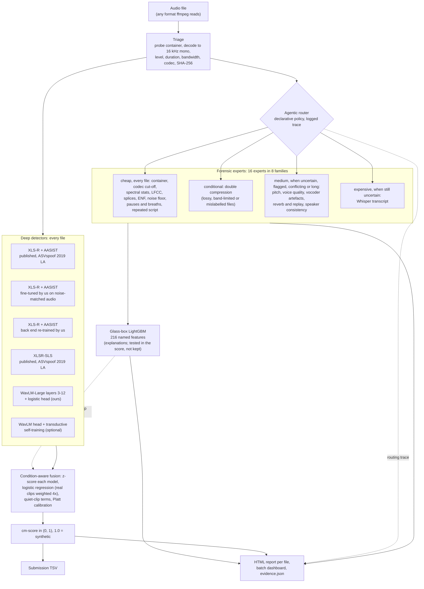

# HEARSAY: detecting synthetic speech and explaining the call

**Team dh squad** · NSA HEARSAY challenge · HackGT 13, September 2026

HEARSAY reads an audio clip and returns the probability that the speech in it is synthetic
(1.0 = synthetic), together with a forensic report that shows the evidence behind the number. The score
is a condition-aware fusion of four deep anti-spoofing detectors: two published XLS-R models, the same
XLS-R + AASIST model with its back end re-trained by us on audio that matches the test set's noise, and a
small classifier we trained on WavLM-Large features. The evidence in each report comes from 16 forensic
experts covering pitch, pauses and breaths, spectral dynamics, reverberation, compression traces, splices,
speaker identity and the spoken text, plus a glass-box model over 216 of their named measurements. A
rule-based "agentic" router decides which forensic analyses each file needs and logs why. Before
training anything we studied the test set itself. It turned out to be VCTK / ASVspoof 2019-style speech (not
DiffSSD), processed by a pipeline we could reproduce, with background noise added. That finding shaped every
later decision.

- **Result:** the submitted fusion (v3) reaches a cross-validated minDCF of **0.098** on test-matched ASVspoof
  2019 LA dev audio with seen attack types and **0.206** on synthesis families no component was trained on
  (EER 3.7% and 6.0%), against 0.198 and 0.276 for the best-known published detector under the same noise.
  **[FINAL: add the organizers' test-set minDCF from the one-time feedback, if they send it]**
- **Run it** (after the setup in [Section 9](#9-how-to-run)):

```bash
python -m hearsay.cli predict data/HackGTHearsayTesting \
    --meta submissions/v3/fusion_meta.json \
    --template data/HackGTHearsayTesting/HGT_Hearsay_score_template.csv \
    --out submissions/final/dh_squad_predictions.tsv
```

With Docker, one `docker run` does the same; see [docs/DOCKER.md](docs/DOCKER.md).

## Contents

1. [The challenge and what the metric rewards](#1-the-challenge-and-what-the-metric-rewards)
2. [What the data told us before we trained anything](#2-what-the-data-told-us-before-we-trained-anything)
3. [System architecture](#3-system-architecture)
4. [Training data and integrity](#4-training-data-and-integrity)
5. [Results](#5-results)
6. [What worked and what did not](#6-what-worked-and-what-did-not)
7. [The 16 forensic experts](#7-the-16-forensic-experts)
8. [Agentic orchestration and the reports](#8-agentic-orchestration-and-the-reports)
9. [How to run](#9-how-to-run)
10. [Repository layout](#10-repository-layout)
11. [Credits, licences and team](#11-credits-licences-and-team)

More detail: [docs/ARCHITECTURE.md](docs/ARCHITECTURE.md) (component by component),
[docs/FINDINGS.md](docs/FINDINGS.md) (every measurement about the data), [docs/DOCKER.md](docs/DOCKER.md).

---

## 1. The challenge and what the metric rewards

The brief, in short:

- 1,671 test clips: 16 kHz WAV, English, all longer than 3 s, about 70% real.
- One score per file (tab-separated `filename` / `cm-score`, every row, in template order), from 0.0 =
  confident real to 1.0 = confident synthetic.
- Judging: 60% minDCF, 20% diversity, quality and depth of techniques, 20% this documentation.

The metric is the ASVspoof 5 minimum detection cost with the organizers' settings (P_spoof = 0.5,
C_miss = 1, C_fa = 4). After normalisation it reduces to

```
minDCF = min over thresholds t of  [ P_miss(t) + 4 * P_fa(t) ]
```

where P_miss(t) is the share of synthetic clips scored below t and P_fa(t) the share of real clips scored at
or above t. Flagging nothing already gives 1.0 and a perfect ranking gives 0. Moving the threshold to flag 1%
more of the real clips only pays off if it catches at least 4% more of the fakes.

What that meant for our design:

| The metric... | ...so we |
|---|---|
| looks only at the ranking | chose detectors, layers, checkpoints and the fusion's regularisation by minDCF, never by accuracy, and write strictly unique scores inside (0, 1), because ties and saturated values can only hurt |
| makes a false alarm 4 times as expensive as a miss | weight real clips 4x in every classifier we train. The best threshold sits where false alarms are rare, so the score is decided by whether the fakes we are sure of rank above nearly every real clip |
| punishes confident mistakes on real speech | measure false alarms on real voices that no model trained on (LJ Speech, held-out LibriSpeech speakers), not only on the benchmark's own speakers |
| ignores calibration | still calibrate the output (Platt scaling, shifted to the brief's 30% synthetic prior), so the number in a report means something. This never changes the ranking |

## 2. What the data told us before we trained anything

We treated the challenge data as evidence before building detectors. Every measurement is in
[docs/FINDINGS.md](docs/FINDINGS.md); these four findings changed our plan.

**The test set is not DiffSSD.** The organizers provided DiffSSD (70,000 clips from 10 TTS systems) and 242
real LJ Speech clips, so the natural assumption is that the test set looks like them. It does not:

| Evidence | Test set | DiffSSD / LJ Speech |
|---|---|---|
| Spoken content (Whisper transcripts of all 1,671 clips) | VCTK prompts: Glasgow Herald sentences, the Rainbow Passage, "Please call Stella" | ChatGPT-written sentences (DiffSSD), 19th-century non-fiction (LJ) |
| Clip length | 3.0–13.6 s, 81% between 3 and 4 s | medians 6–10 s |
| Script matches | 0 of the sampled test clips match any of DiffSSD's 5,000 scripts | — |

VCTK is the source corpus of the ASVspoof 2019 LA benchmark. We therefore moved our main training and
validation data to the public ASVspoof 2019 LA train and dev partitions, and used DiffSSD as a source of
modern generators: three of its ten generators for training, and seven held out that none of our trained
components ever heard.

**We could reproduce the organizers' preprocessing.**

- 94% of test clip lengths are an exact whole number of 512-sample hops at 22,050 Hz: the signature of
  `librosa.load()` at its default rate followed by `librosa.effects.trim()`.
- The shortest clip is exactly 130 hops (3.019 s), so clips shorter than 3 s after trimming were dropped.
- Every file is 16 kHz mono PCM16, peak-normalised (median peak 0.998), with the identical
  `LIST/INFO/ISFT = Lavf58.29.100` header: one ffmpeg run rewrote all container metadata.
- File timestamps span 28 minutes with uniform signal statistics, so processing order does not leak labels.

[`hearsay/preprocess.py`](hearsay/preprocess.py) replicates this pipeline, and every training and validation
clip goes through it. Clip length, loudness, sample rate and container can therefore not act as shortcuts.

**The organizers added noise.** Passing ASVspoof 2019 LA dev through our replica reproduces the test set's
statistics closely, with one exception:

| | Median duration | Share 3–4 s | Spectral roll-off (−20 / −40 dB) | Median noise floor |
|---|---|---|---|---|
| ASVspoof 2019 LA dev, our replica | 3.58 s | 74–82% | 7,671 / 7,765 Hz | −61 dBFS |
| HEARSAY test set | 3.41 s | 81% | 7,609 / 7,718 Hz | **−44 dBFS** |

The test audio is about 17 dB noisier, which matches the brief ("added noise to real/synthetic is still
real/synthetic"). This one number explains most of what follows: noise, not unfamiliar attacks, is what
breaks the published detectors here (Section 5).

**The scorer's direction is flipped.** The organizers' scoring code is the ASVspoof 5 Track-1 package with two
parameters changed (P_spoof 0.05 to 0.5, C_fa 10 to 4; we diffed it against the upstream repository). That code
treats a *higher* score as bona fide, while the submission format asks for 1.0 = synthetic. Run unmodified on
correctly oriented scores, a perfect detector gets minDCF = 1.0. We follow the written specification, told the
organizers about the mismatch, and [`hearsay/metrics.py`](hearsay/metrics.py) reports both readings. Every
number in this README uses the written specification.

## 3. System architecture



Nine evidence categories flow through one contract ([`hearsay/evidence.py`](hearsay/evidence.py)): the eight
forensic families plus "deep". Below is each component, what it adds and what it costs (times are per clip on
our 16 GB Apple-silicon laptop, clips of 3–4 s):

**Triage** ([`hearsay/orchestrator.py`](hearsay/orchestrator.py)). Probes the container with ffprobe, decodes
to 16 kHz mono, and records duration, level, clipping, silence, effective bandwidth, codec, lossy or lossless,
extension mismatch and a SHA-256 of the bytes. These facts steer the router and fill the report's
chain-of-custody table. About 30–40 ms.

**XLS-R + AASIST, published** (`w2v2_aasist`). Tak et al.'s wav2vec 2.0 XLS-R 300M front end with an AASIST
graph-attention back end, trained on ASVspoof 2019 LA, run through ONNX. It is excellent on clean audio
(minDCF 0.036 on our replica of LA dev) and holds up well on generators it never saw, but test-matched noise
makes it 5.5 times worse (0.198) and it calls 97.5% of genuine LJ Speech clips fake. About 0.2 s on CPU;
1.3 GB.

**XLSR-SLS, published** (`xlsr_sls`). Zhang et al.'s (ACM MM 2024) XLS-R model with a "sensitive layer
selection" head that pools evidence from several transformer layers, also trained on ASVspoof 2019 LA. It does
better on noise-matched dev (0.146), raises fewer false alarms on LJ Speech (56%), and gives a second,
differently built opinion from the same backbone family. Similar cost; 1.4 GB.

**XLS-R + AASIST, fine-tuned by us** (`tak_ft`). We ported the model from fairseq to Hugging Face transformers
([`hearsay/tak_aasist.py`](hearsay/tak_aasist.py); largest difference to the ONNX export 3e-5) and fine-tuned
the top 6 of its 24 transformer layers plus the back end on the laptop GPU, with fresh test-matched noise in
every batch and real voices from both VCTK and LibriSpeech. It attacks the failure above directly: noise, not
the attacks, is what hurts the published model. On the 800 matched-dev clips that picked the checkpoint,
minDCF went from 0.172 to 0.145 (step 2,000). On the whole matched dev set the gain is smaller (0.198 to
0.181), false alarms on LJ Speech fall from 97.5% to 5%, but it lost most of the published model's reach to
unseen generators (Section 5). Training takes about 1.1 s per step (2,000 steps, about 40 minutes); scoring
is one forward pass per 4 s window, about 0.11 s per clip on the laptop GPU and 0.32 s on 2 CPU threads
(measured on 8 clips).

**XLS-R + AASIST, back end re-trained by us** (`tak_head`). The same recipe with XLS-R frozen: only the AASIST
back end (0.45 M parameters) learns from the noise-matched audio (1,500 steps, about 0.7 s each; best
checkpoint at step 600, 0.172 to 0.149 on the 800 selection clips). Leaving the XLS-R features untouched keeps
most of the published model's reach to unseen generators (Section 5), and unlike the full fine-tune it helps
the fusion (v2i, v3). Same scoring cost as `tak_ft`.

**WavLM-Large head** (`wavlm_head`). Frozen WavLM-Large; we average the hidden states of layers 3–12 over time
(10 x 1,024 numbers), standardise them and apply a logistic regression trained on noise-matched data with real
clips weighted 4x. It is the best single model on seen attacks (0.111) and flags only 7% of LJ Speech and 4%
of held-out LibriSpeech speakers, but catches fewer unseen generators than the XLS-R models. The head is one
linear layer (10,240 weights and a bias); the cost is one WavLM forward pass over the first 6 s, about 0.07 s
per clip on the laptop GPU and 0.75 s on 2 CPU threads (measured on 8 clips). Our first head (used up to v2g)
took only the probe's best four layers, 6–9, and scored 0.131 on seen attacks (Section 6).

**Self-training, optional** (`wavlm_selftrain`). Semi-supervised and transductive, with no labels: the
ensemble's most confident test clips become pseudo-labels (top 15% as synthetic, bottom 50% as real) and the
WavLM head is refit twice with them, so it can learn the test set's own attack signatures. In a labelled
simulation (VCTK real speech + unseen DiffSSD generators) it improved the fused minDCF from 0.269 to
0.229–0.251. It reuses the WavLM features, so it only adds three logistic-regression fits per batch, but it
makes one file's score depend on the rest of the batch. **It is off in the submitted fusion (v3):** on the full
dev mix it made the fusion worse (Section 5), because its pseudo-labels inherit the XLS-R detectors' mistakes
on quiet clips.

**Forensic experts** ([`hearsay/experts/`](hearsay/experts/)). Sixteen interpretable analyses in eight
families (Section 7). Each returns named numbers plus plain-English findings with a direction and a strength.
The 13 experts that feed the glass-box model take about 0.35 s together; all 16 take about 0.7 s, mostly the
speaker-embedding and compression-grid experts.

**Glass-box model** (`forensic_gbm`). LightGBM over 216 named expert features, after dropping features that
are constant on the test set, flagged by an expert's author as corpus shortcuts, or that tell our dev data
apart from the test set (adversarial validation). Alone it is weak (minDCF 0.48). We tried it inside the
fusion: it earns a small positive weight, but the fusion scores slightly better without it (0.146 vs 0.151 on
the fusion dev set), so the submitted score (v3) leaves it out. Its features are what the reports explain.
Milliseconds once the features exist.

**Fusion and calibration** ([`scripts/make_submission.py`](scripts/make_submission.py) writes
`submissions/<version>/fusion_meta.json`; [`hearsay/pipeline.py`](hearsay/pipeline.py) applies it). Each
detector's log-odds is z-scored with dev statistics, a logistic regression (real clips weighted 4x,
regularisation chosen by grouped cross-validated minDCF) combines them, and Platt scaling plus a prior shift
to 30% synthetic turn the result into a probability. The dev set mixes seen attacks with held-out, unseen
generators, so the weights are not tuned only to attacks the models already know. From v2d on, the fusion is
condition-aware (`--cond`): a quiet-clip indicator (noise floor below −55 dBFS) and one model-by-quiet term per
detector let the weights differ on very clean clips, which are strongly spoof-leaning (Section 7,
`noise_floor`). The config lists which detectors run and stores the full-precision coefficients
(`coef_full`), so a new fusion needs no code change and `predict` reproduces `make_submission.py`'s TSV byte
for byte from the same scores. Negligible cost.

**Agentic router** ([`hearsay/orchestrator.py`](hearsay/orchestrator.py)). A declarative policy decides per
file which forensic analyses to run: cheap tripwires always, compression history only for lossy or
band-limited files, slower talker-level analyses only when the evidence is uncertain, conflicting or strongly
flagged, and Whisper only if the file is still uncertain. Every rule evaluation is logged with its reason. On
20 random test clips it used 39% of the analysis time of running every expert (Section 8).

**Reports** ([`hearsay/report.py`](hearsay/report.py)). One self-contained HTML page per file (verdict,
summary, chain of custody, waveform and spectrogram with seams and cut-off marked, pitch contour, evidence by
category, routing trace, evidence that had no effect), a batch dashboard, and `evidence.json` with everything.

**One run, two outputs.** The submitted score does not depend on routing: every file gets the same four
detector scores. The router decides which forensic analyses (cheap tripwires always; speaker consistency,
Whisper transcript, compression grid and the other slower experts only when needed) run for the report. In the report the detector ensemble
appears as one "deep" evidence item that lists each detector's score and how far it moved the fused score,
and the report's verdict is exactly the value in the TSV.

**How we kept the black boxes in check.** The brief asks to minimise black-box detectors. Honestly, the deep
detectors carry the ranking power; the glass-box model alone reaches only 0.48, and adding it to the fusion
did not improve minDCF, so we did not put it in the score just to claim that. What we did instead:
(1) we can say where the deep evidence lives (middle WavLM layers, Section 6); (2) the fusion is twelve
weights you can read in `fusion_meta.json`, including how they change on quiet clips; (3) every report puts
the interpretable findings next to each detector's contribution, so an analyst sees *why*, not just a number;
(4) the glass-box model's most useful features have plain meanings (how fast the spectral envelope changes,
how much of the clip is speech, reverberation, harmonic structure, pitch variability).

## 4. Training data and integrity

| Source | Clips we use (after dropping clips under 3 s) | Role |
|---|---|---|
| ASVspoof 2019 LA **train** (VCTK speakers, attacks A01–A06) | 13,610 (1,580 real, 12,030 fake). Noise-matched copy: all 1,580 real + 1,000 per attack | main training data |
| ASVspoof 2019 LA **dev** (other speakers, same 6 attacks) | 13,824 (1,628 / 12,196). Noise-matched copy: all 1,628 real + 250 per attack = 3,128 | validation, model selection, fusion fitting |
| DiffSSD (provided) | 991 (about 100 per generator, 10 generators) | 3 generators for training (DiffGAN-TTS, ElevenLabs, OpenVoice V2; 297 clips); 7 held out (Grad-TTS, PlayHT, ProDiff, UnitSpeech, WaveGrad 2, XTTS v2, YourTTS; 694 clips) |
| LJ Speech (provided) | 242 | validation only: an unfamiliar real voice |
| LibriSpeech dev-clean | 2,290 from 40 speakers | real voices that are not VCTK: 25 speakers (1,441 clips) for training, 15 speakers (849) held out |
| Our own macOS `say` TTS ([`scripts/gen_say.py`](scripts/gen_say.py)) | 827 from 32 English voices | "test yourself": 15 voices (376 clips) for training, 17 voices (451) held out |
| MUSAN noise | 400 recordings (120 in fine-tuning) | augmentation only |

Our TTS clips read the same kind of text VCTK speakers read (Rainbow Passage, "Please call Stella", news-style
sentences), so real and synthetic training audio share vocabulary and text cannot become a shortcut.

**Building test-matched data** ([`hearsay/preprocess.py`](hearsay/preprocess.py),
[`hearsay/augment.py`](hearsay/augment.py), [`scripts/build_matched.py`](scripts/build_matched.py)):

1. **Replica of the organizers' pipeline** for every clip. Sources much longer than the test clips (DiffSSD,
   LibriSpeech) are cropped to a length drawn from the test set's duration distribution, on the 512-hop grid.
2. **Distribution-matched noise.** We measured each test clip's noise floor (10th percentile of 20 ms frame
   RMS). For every training clip we draw a target floor from that distribution and add MUSAN noise (or
   coloured noise, 30% of the time) until the clip reaches it. Real and fake clips get exactly the same
   treatment, so noise can never become a label shortcut.
3. **Codecs.** About 5% of clips pass through a lossy round trip (MP3, AAC, Opus, G.726, G.722, µ-law),
   mirroring the roughly 5% of band-limited, telephony-like test clips.

The fine-tuning job draws fresh noise every time it uses a clip, so the model cannot memorise one noisy copy.

**Integrity rules we kept:**

- **No ASVspoof 2019 LA evaluation data.** [`scripts/prep_la.py`](scripts/prep_la.py) extracts only the train
  and dev members of the archive and asserts that no evaluation file is among them. The test set appears to
  come from the same VCTK / ASVspoof 2019 family, so evaluation audio or keys could leak test answers.
- **No detectors trained on it either.** For the same reason we excluded published checkpoints trained or
  tuned on ASVspoof 2019 LA evaluation data (or on ASVspoof 2021 evaluation audio, which is built from it).
  A good score from such a model would say nothing about generalisation. Both detectors we use were trained on
  ASVspoof 2019 LA training data only: Tak et al.'s LA checkpoint (train partition, RawBoost augmentation) and
  XLSR-SLS (train partition, dev used for checkpoint selection). We rejected NII's AntiDeepfake models, whose
  published training protocol lists ASVspoof 2019 LA *train and eval* and all of ASVspoof 2021 LA/DF, and did
  not use the DF-Arena or Spectra checkpoints because their training partitions are not documented.
- **Held-out means unseen groups.** DiffSSD is split by generator, our TTS by voice and LibriSpeech by speaker
  (a hash of the group name). "Held-out" numbers measure unseen generators, voices and speakers, not just
  unseen clips.
- **No test labels.** The provided key is a uniform template. We did use the unlabelled test audio, in four
  places: to measure the noise-floor and duration distributions we match, to transcribe the prompts (data
  analysis), in the glass-box model's adversarial-validation feature filter, and in the optional
  self-training.

## 5. Results

All numbers are minDCF under the written specification, computed with
[`hearsay/metrics.py`](hearsay/metrics.py). "Flagged" means the clip lands on the synthetic side of the model's
own decision boundary (log-odds above 0; for the fusion, calibrated probability above 0.5).

- **(a) Seen attacks:** noise-matched ASVspoof 2019 LA dev, 1,628 real + 1,500 fake (A01–A06), speakers not in
  training.
- **(b) Unseen generators:** the same 1,628 real clips + 1,145 fakes from generators no trained component saw
  (7 DiffSSD generators, 694 clips; 17 macOS voices, 451 clips).
- **(c) Unfamiliar real voices:** share of genuine clips flagged, LJ Speech (242) / held-out LibriSpeech
  speakers (849; the glass-box model was scored on 319 of them).

| Component | (a) Seen attacks, minDCF (EER) | (b) Unseen generators, minDCF (EER) | (c) Real clips flagged, LJ / LibriSpeech |
|---|---|---|---|
| XLS-R + AASIST, published | 0.198 (6.4%) | 0.276 (6.8%) | 97.5% / 80.0% |
| XLSR-SLS, published | 0.146 (6.1%) | 0.274 (9.3%) | 55.8% / 54.8% |
| XLS-R + AASIST, fine-tuned by us | 0.181 (4.9%) | 0.541 (12.4%) | 5.0% / 4.7% |
| XLS-R + AASIST, back end re-trained by us | 0.179 (5.2%) | 0.305 (8.7%) | 38.4% / 16.0% |
| WavLM-Large head (ours) | 0.111 (3.5%) | 0.344 (10.4%) | 7.4% / 4.0% |
| Forensic glass-box model (ours) | 0.476 (15.6%) | 0.475 (15.5%) | 20.7% / 12.9% |
| **Fusion (submitted, v3; out of fold)** | **0.098 (3.7%)** | **0.206 (6.0%)** | 37.6% / 15.7% |

How to read it:

- The same published XLS-R + AASIST scores 0.036 (EER 0.8%) on the clean replica of the same dev clips.
  Added noise alone makes it 5.5 times worse.
- The published XLS-R detectors generalise best to generators they never saw, but raise many false alarms on
  unfamiliar real voices. Our WavLM head, trained on noise-matched data with non-VCTK real voices, is the
  reverse: best on seen attacks, few false alarms, weaker on unseen generators. That complementarity is why
  fusion helps.
- On the unseen generators the detectors catch most fakes at their own boundaries (XLS-R + AASIST 97% of the
  held-out DiffSSD clips and 99% of the held-out macOS voices; WavLM head 63% and 98%; glass-box 49% and 90%).
  The fine-tuned XLS-R + AASIST is the exception: it still catches 99% of the macOS voices but only 37% of the
  held-out DiffSSD clips. Re-training only its back end keeps 68% and 98%. Details in
  [docs/ARCHITECTURE.md](docs/ARCHITECTURE.md).

**Fusion against the best single model**, on the fusion dev set ((a) and (b) pooled: 1,628 real, 2,645 fake;
fusion numbers are grouped 5-fold cross-validation, out of fold):

| | minDCF |
|---|---|
| XLS-R + AASIST / fine-tuned / back end re-trained / WavLM head / glass-box, each alone | 0.243 / 0.359 / 0.249 / 0.214 / 0.476 |
| XLSR-SLS alone (best single model) | 0.204 |
| Fusion of the three deep detectors (v2b, first WavLM head) | 0.181 |
| + glass-box model (v2c) | 0.178 |
| + condition-aware quiet-clip terms (v2d) | 0.156 |
| same, with the current WavLM head (v2h) | 0.154 |
| + back-end-re-trained XLS-R + AASIST (v2i) | 0.151 |
| same without the glass-box model (v3) | 0.146 |
| **Submitted fusion (v3)** | **0.146** |

**Our submissions, in order:**

| Version | What changed | Fusion dev minDCF |
|---|---|---|
| v0 | Average of two AASIST models trained on ASVspoof 2019 LA (a safety net) | – |
| v1 | Equal-weight average of the two published XLS-R detectors | – |
| v2a | + WavLM head; logistic fusion fitted on seen attacks only | 0.114 (seen attacks only; not comparable) |
| v2b | Same three models; the fusion dev set adds held-out unseen generators | 0.181 |
| v2c | + forensic glass-box model | 0.178 |
| v2d | + condition-aware quiet-clip terms (`--cond`) | 0.156 |
| v2e | v2d + fine-tuned XLS-R + AASIST (it got a negative weight) | 0.164 |
| v2f | v2d with the self-trained WavLM head instead of the plain one | 0.179 |
| v2g | v2d with both the plain and the self-trained WavLM head | 0.155 |
| v2h | v2d with the WavLM head retrained on layers 3–12 | 0.154 |
| v2i | v2h + back-end-re-trained XLS-R + AASIST (`tak_head`) | 0.151 |
| v3 | v2i without the glass-box model: XLS-R + AASIST, XLSR-SLS, WavLM head, `tak_head` | 0.146 |
| **final** | **v3 is what we submit** | **0.146** |

v2a–v2g used the first WavLM head (layers 6–9), whose weights were replaced when the head was retrained for
v2h, so only v2h and later versions can be reproduced from the current model files.

Two more measurements: transductive self-training improved the fused minDCF from 0.269 to 0.229–0.251 in a
labelled simulation (VCTK real + unseen DiffSSD generators), yet in the real fusion it barely changed the
cross-validated minDCF next to the plain head (v2g 0.155 vs v2d 0.156) and was worse instead of it (v2f 0.179).
Fine-tuning XLS-R + AASIST lowered minDCF on the 800 matched-dev clips that picked its checkpoint from 0.172 to
0.145, but in the fusion it made things worse (v2e).
**[FINAL: organizer feedback on the test set, if we used the one-time check]**

## 6. What worked and what did not

The NSA brief asks for both. Everything here is measured; numbers are from Section 5 and
[docs/FINDINGS.md](docs/FINDINGS.md).

**What worked**

- **Studying the test set before modelling.** Without it we would have trained on DiffSSD versus LJ Speech,
  which is the wrong domain.
- **Reproducing the organizers' preprocessing** for every training and validation clip, which removed length,
  loudness, sample rate and container as shortcuts.
- **Training with distribution-matched noise.** A plain logistic regression on frozen WavLM features, trained
  this way, beats both published detectors on seen attacks (0.131 for our first head and 0.111 for the current
  one, vs 0.146 / 0.198) and flags 7–8% of genuine LJ clips instead of 97.5%.
- **Adding real voices that are not VCTK** (LibriSpeech) and our own TTS clips to training.
- **Looking inside WavLM.** A per-layer probe shows the spoofing evidence peaks in the middle layers: layers
  6 and 7 reach minDCF about 0.24 and layers 8–10 about 0.25–0.27, against 0.77 for the input embeddings and
  0.38 for the top layer. Low layers are raw acoustics, top layers are about words; synthesis traces sit in
  between. Our first head used the best four layers, 6–9; widening it to layers 3–12 improved seen attacks
  from 0.131 to 0.111 (the layers were chosen on our evaluation data, so both numbers are slightly
  optimistic).
- **Fusion across model families** with weights fitted on seen and unseen attacks (best single model 0.204,
  four-model fusion 0.178; 0.154 with the condition-aware quiet-clip terms and the current WavLM head; 0.146
  in v3).
- **Re-training only the AASIST back end on noise-matched audio**, with XLS-R frozen. Alone it is no better
  than the published model on the fusion dev set (0.249 vs 0.243), but adding it improved the fusion from
  0.154 (v2h) to 0.151 (v2i).
- **Condition-aware fusion.** Letting the weights differ on very clean clips (noise floor below −55 dBFS)
  improved the cross-validated minDCF from 0.178 to 0.156 (v2c to v2d).
- **Transductive self-training, in simulation** (0.269 to 0.229–0.251; but see below for the real fusion).

**What did not work**

- **Fine-tuning XLS-R + AASIST on noise-matched audio: a trade, not a win.** It cut false alarms on LJ Speech
  from 97.5% to 5% and improved seen attacks a little (0.198 to 0.181), but it forgot much of what made the
  published model generalise: on unseen generators minDCF went from 0.276 to 0.541 (it catches 37% of the
  held-out DiffSSD clips instead of 97%). In the fusion it got a negative weight and made the
  cross-validated minDCF worse (0.156 to 0.164, v2e). Keeping XLS-R frozen and re-training only the back end
  avoided this (see What worked).
- **Transductive self-training in the real fusion.** It helped in the labelled simulation (0.269 to
  0.229–0.251), but on our fusion dev set it did not beat the plain WavLM head (v2f 0.179, v2g 0.155 vs v2d
  0.156).
- **Detectors trained only on VCTK treat unfamiliar real voices as fake.** The strongest published detector
  catches 97.2% of DiffSSD and 99.4% of our macOS fakes, but also flags 97.5% of genuine LJ Speech. It learned
  "real = VCTK studio audio".
- **Published detectors under noise:** 0.036 on clean dev, 0.198 once test-matched noise is added.
- **Denoising before detection made things worse** (spectral gating: minDCF 0.13–0.17 vs 0.11 on the same
  clips). Removing noise also removes the fine detail the detectors rely on; training *with* matched noise is
  what worked.
- **Training on the provided data alone.** DiffSSD fakes and LJ reals differ in speaker, text, sample rate,
  loudness, length and mains hum, so a model separates them without learning anything about synthesis.
- **The provided ASVspoof 5 AASIST baseline** flags 0.6% of test clips (about 30% expected). ASVspoof 5 is built
  from LibriVox audiobooks, not VCTK.
- **Container and metadata forensics:** every test header is identical (rewritten by ffmpeg), so they carry no
  class information here. They still matter for real-world files (they caught DiffSSD PlayHT files named
  `.wav` that are MP3 inside).
- **Mains hum (ENF):** absent from the test set.
- **Classic forensic cues on their own:** minDCF 0.48 on laundered, noisy audio.
- **Speaker-consistency drift** does not separate whole-utterance TTS from real speech; it only finds splices.
- **The compression-grid detector** finds MP3 traces at 32 kbps (10 of 10 clips) but rarely at 64 kbps
  (1 of 10) and not at 128 kbps.
- **A bug we caught:** our first WavLM features were pooled in fp16 on the Mac GPU; summing hundreds of frames
  overflowed fp16's 65,504 limit. We now pool in float32.

**Limitations we know about**

- Our dev numbers are slightly optimistic: the matched dev set also chose the fine-tuning checkpoint, the
  WavLM layers and the fusion weights (the fusion numbers themselves are cross-validated).
- The test set is VCTK-based and so is most of our real training speech. Part of any detector's skill here is
  "does this sound like VCTK studio audio?". LibriSpeech voices reduce that, but on other domains false alarms
  would be higher.
- Some of the most useful forensic features (leading silence, speech fraction) may describe how ASVspoof 2019
  was recorded and generated rather than synthesis in general.
- The manipulation-type label in the reports (TTS, voice conversion, replay, splice, laundering) comes from
  written rules, not a trained classifier, and we could not test it on labelled voice-conversion or replay data.
- We did not build an emotion expert, and everything was tested on English only (as the brief specifies).

## 7. The 16 forensic experts

Each expert is a function registered with `@expert(name, category, cost)` in
[`hearsay/experts/`](hearsay/experts/). It returns named numeric features for the glass-box model and
plain-English findings (direction: synthetic, genuine or neutral; strength 0–1) for the reports. An expert can
never crash the pipeline: failures are recorded and shown in the report. Cost is the mean time per call on 20
random test clips in full mode (experts share cached intermediates such as the STFT).

| Expert | Family | Tier (cost) | What it measures | What we observed |
|---|---|---|---|---|
| `container` | container | cheap (0.5 ms) | Real format vs extension, ffprobe stream facts, RIFF chunk walk, ID3/LAME/MP4/Vorbis tags, encoder signatures, embedded vs filesystem timestamps, SHA-256 | Every test header is the same (`Lavf58.29.100`), so it reports "uninformative" instead of guessing; excluded from the glass-box model. Caught DiffSSD PlayHT MP3s named `.wav`. |
| `codec_cutoff` | compression | cheap (7 ms) | Low-pass edge of the long-term spectrum, its depth and steepness, the codec or resampler chain that explains it, hidden band limits | About 5% of test clips are band-limited. Its cut-off frequency and bandwidth features separated our dev data from the test set rather than real from fake, so the shift check dropped them; only its noise-floor measurements stayed in the glass-box model. |
| `double_compression` | compression | conditional (200 ms) | Spectral holes, loss of high-band flatness, and an MDCT block-grid scan (576-sample MP3 granules, 1,024-sample AAC frames) | On our re-encodings of 10 test clips: grid found 10/10 at MP3 32 kbps, 1/10 at 64 kbps, 0/10 at 128 kbps, 0/10 originals; double MP3 coding flagged 4/4. |
| `spectral_stats` | spectral | cheap (11 ms) | High-band vs speech-band energy, bandwidth, flatness, centroid, roll-off, flux, frame-to-frame roughness of sub-band energies; draws the report spectrogram | Feeds the glass-box model; its cut-off and high-band variability features were dropped by the shift check. |
| `lfcc_stats` | spectral | cheap (1 ms) | 20 linear-frequency cepstral coefficients plus deltas (the ASVspoof baseline front end), mean and spread | How fast the spectral envelope changes (LFCC delta spread) gave the glass-box model its most useful features (1st and 3rd). |
| `vocoder_artifacts` | spectral | medium (67 ms) | Harmonic-to-noise regularity, harmonic phase coherence, group delay, spectral lines from upsampling layers, frame-rate lines in the modulation spectrum, low-harmonic sharpness | Low-harmonic structure was the 5th most useful glass-box feature. Skipped for narrowband audio. |
| `pitch` | prosody | medium (14 ms) | Praat F0 contour: range, declination, micro-prosody smoothness, octave jumps; jitter, shimmer, harmonics-to-noise ratio | Pitch variability and shimmer are in the glass-box model's top 10. |
| `pauses_breaths` | prosody | cheap (8 ms) | Pauses (webrtcvad), speech and articulation rate from syllable nuclei, rhythm regularity, a breath detector | Share of the clip that is speech (2nd), leading silence (6th) and speaking rate (7th) were among the most useful features. |
| `voice_quality` | prosody | medium (25 ms) | Formants F1–F3 and their bandwidths, smoothness of formant movement, H1–H2, cepstral peak prominence, spectral slope, creaky voice | Formant bandwidths and the share of creaky voice are in the top 15. |
| `enf` | environment | cheap (4 ms) | Mains hum at 50/60 Hz and harmonics, and how stable its frequency and level are over time | No hum anywhere in the test set; the shift check dropped all but one of its features. Still useful on real-world recordings. |
| `noise_floor` | environment | cheap (0.4 ms) | Background level in the pauses, speech-to-noise ratio, stationarity across pauses, noise colour, whether the noise under speech matches the noise in pauses | This measurement revealed the organizers' added noise. Very clean floors (below −55 dBFS, about 160 clips) are strongly spoof-leaning*; very noisy clips (above −35 dBFS, about 70) are a false-alarm risk. |
| `reverb_replay` | environment | medium (6 ms) | Energy decay after speech offsets (T60), level drop 50 ms after offsets, a modulation-based reverberation ratio (SRMR-like), loudspeaker-like low-frequency roll-off and ripple | The reverberation ratio was the 4th most useful glass-box feature. |
| `discontinuity` | splice | cheap (4 ms) | Runs of exact digital zeros (leading, interior, trailing), DC-offset steps, noise-floor change points, clicks, re-quantisation combs; seam times for the report | 24 test clips have interior digital-silence runs of 5 ms or more; half of them are spoof-leaning* (16% overall). The test set has no partial fakes, so here it acts as a generation-artefact detector. |
| `speaker_consistency` | speaker | medium (390 ms) | ECAPA-TDNN voiceprints on 1.5 s windows and a before/after split scan; caches the voiceprint for batch-level speaker clustering | Separates synthetic two-talker splices from genuine clips (AUC about 0.98) and flagged 0 of 20 LJ clips. Within-clip drift does not separate whole-utterance TTS from real speech, so a stable voice counts as neutral. Report only. |
| `transcript` | semantic | expensive (Whisper small.en, about 0.5 s per clip after a 2 s model load on the laptop) | Speaking rate, fillers and disfluencies, word length, recogniser loops, ASR confidence: read vs spontaneous speech | Transcribing all 1,671 test clips is how we recognised the VCTK prompts. The recogniser looped on 2 clips; both were scored strongly synthetic. Report only. |
| `repeated_script` | semantic | cheap (batch-level) | How many other clips in the batch speak the same sentence, how this reading deviates from the others, complete sentence vs fragment | 86 clips speak a sentence that occurs in 5 or more other clips; about 40% of them are spoof-leaning* vs 16% overall. Depends on the batch, so report only. |

\* "Spoof-leaning" means scored on the synthetic side by an AASIST model trained on ASVspoof 2019 LA. It is a
noisy pseudo-label we used to find leads, never to train.

## 8. Agentic orchestration and the reports

"Agentic" here means the pipeline plans its own analysis for each file, like an analyst: look at the cheap
evidence first, and spend time on expensive analyses only where they can change the conclusion. It is a
written, deterministic policy (`POLICY` in [`hearsay/orchestrator.py`](hearsay/orchestrator.py)), not a
language model, so every decision can be printed in a report and reproduced in Docker.
`python -m hearsay.cli policy` prints it.

| Step | Tier | Runs when | Experts |
|---|---|---|---|
| 0 | triage | always | probe, decode, level, bandwidth, codec, hash |
| 1 | cheap | always | container, codec_cutoff, spectral_stats, lfcc_stats, discontinuity, enf, noise_floor, pauses_breaths, repeated_script |
| 2 | deep | a detector ensemble is supplied | the fused detectors give the provisional score |
| 3 | conditional | lossy codec, band-limited audio, or an extension that does not match the container | double_compression |
| 4 | medium | the provisional score is uncertain (within 1 log-odds unit of the threshold), or an expert raises a strong synthetic flag (strength 0.6 or more), or strong findings disagree, or the clip is longer than 6 s; and the file has usable signal | pitch, voice_quality, speaker_consistency, vocoder_artifacts, reverb_replay |
| 5 | expensive | still uncertain after step 4, and the file has usable signal | transcript (Whisper) |

Experts that make no sense for a file are suppressed, and the suppression is logged: vocoder analysis for
narrowband audio (no energy above about 4.5 kHz), speaker consistency and mains hum for clips under 2 s. A
written rule list, first match wins, turns the evidence into a manipulation type: spliced/edited, replay,
voice conversion, TTS / neural vocoder, laundered (transcoded, band-limited or noisy), bona fide, or uncertain.

**Compute saved.** On 20 random test clips, agentic mode spent 5.7 s on expert analysis against 14.8 s for
running every expert on every file: **39% of the compute of full mode** (deep scores and transcripts came from
cache in this measurement, so it compares the forensic analyses). 8 of the 20 files were escalated to the
medium tier, 7 to the expensive tier, and none needed the compression-history check (all 20 were uncompressed,
full-band WAV). Routing does not change the cm-score: the score comes from evidence that is computed for every
file (Section 3). `python -m hearsay.cli compute` runs both modes on any sample and prints the share of files
with identical scores. On the full test set (1,671 files, submitted fusion v3) the router sent 9% of files to the
medium tier and 7% to Whisper, and used **11% of the analysis time** of running every expert (136 s instead of an
estimated 1,265 s). The submitted scores are identical either way, because the score does not depend on routing
(all 1,671 report verdicts equal the TSV).

**What a report contains.** Each file gets a self-contained HTML page (plots are embedded, so it can be
e-mailed): the verdict with a gauge and the manipulation type; a plain-English summary of why; a
chain-of-custody table (size, SHA-256, container, codec, sample rate, encoder, tags, modification time); an
evidence-balance chart by family; waveform and spectrogram with seams, digital-silence runs and the measured
cut-off marked; the pitch contour and speaker-drift curve when those experts ran; every finding grouped by
family with its direction, strength and cost; the full routing trace (each rule, whether it fired, and why);
and the evidence that had no effect (neutral findings, skipped or failed experts). The batch dashboard
(`index.html`) adds the score histogram, flags per family, manipulation types, files per tier, compute per
expert and a sortable file table. `evidence.json` holds all of it in machine-readable form.

## 9. How to run

**Setup** (Python 3.12 or 3.13, which the pinned numpy, scipy and librosa need; `ffmpeg` and `ffprobe` on the
PATH):

```bash
python3 -m venv .venv && source .venv/bin/activate
pip install -r requirements.txt
scripts/fetch_models.sh                        # published weights, pinned to exact Hugging Face commits
scripts/fetch_models.sh --own https://github.com/MeagerPotato/hearsay-dh-squad/releases/download/v1.0/hearsay-models-v3.tar.gz --own-only   # our trained artifacts
python -m hearsay.paths --meta submissions/v3/fusion_meta.json         # checks every file is there
```

Model files are not in git (each large model is about 1.3 GB). They live in `work/models/`, or wherever the
`HEARSAY_MODELS` environment variable points.

**Score a folder and write the submission TSV** (only the detectors listed in the fusion config are run, one
model in memory at a time; scores are cached per model, so a re-run only computes what changed):

```bash
python -m hearsay.cli predict data/HackGTHearsayTesting \
    --meta submissions/v3/fusion_meta.json \
    --template data/HackGTHearsayTesting/HGT_Hearsay_score_template.csv \
    --out submissions/final/dh_squad_predictions.tsv \
    --reports reports/          # optional: HTML report per file + dashboard
```

It also writes `<out>_scores.json` with every detector's log-odds, the fused log-odds and the probability for
each file. `--device cpu` forces CPU (the default picks CUDA, then Apple MPS, then CPU).

**Explore and explain:**

```bash
python -m hearsay.cli explain data/HackGTHearsayTesting/HGT1013455.wav --html reports/HGT1013455.html
python -m hearsay.cli report data/HackGTHearsayTesting --out reports/ --limit 50
python -m hearsay.cli compute data/HackGTHearsayTesting --limit 20   # agentic vs full compute
python -m hearsay.cli policy                                          # the routing policy in plain text
python -m hearsay.cli experts                                         # installed experts and their costs
```

`explain` prints the verdict, the findings (strongest first) and the routing trace. Whisper only runs for files
without a cached transcript; add `--skip transcript` to never run it. For reports whose verdict is the submitted
score, use `predict --reports`: without a deep scorer, `explain` and `report` fall back to a transparent,
hand-weighted vote of the expert findings. `predict` also takes a single file, so one file with the submitted
ensemble and its report is `python -m hearsay.cli predict FILE --meta <fusion_meta.json> --out one.tsv
--reports reports/one/`.

**Docker.** The image contains the code, the Python environment, ffmpeg and the model files, and runs on CPU;
[docs/DOCKER.md](docs/DOCKER.md) has the build and run commands. After `docker build -t hearsay-dhsquad .`,
`docker run --rm -v /path/to/HackGTHearsayTesting:/data:ro -v "$PWD/out:/out" hearsay-dhsquad` scores the test
folder and writes `out/dh_squad_predictions.tsv`. **[FINAL: measured Docker run time]**

**Reproducing our training**, in order (data goes under `data/`, which is not in git; each step lists the
command we ran):

| # | Step | Command |
|---|---|---|
| 1 | ASVspoof 2019 LA train + dev through the pipeline replica (eval never extracted) | `python scripts/prep_la.py` |
| 2 | DiffSSD (100 per generator) and LJ Speech; LibriSpeech dev-clean | `python scripts/prep_misc.py`; `python scripts/prep_misc.py libri` |
| 3 | Our own TTS clips (macOS only) | `python scripts/gen_say.py` |
| 4 | Noise-matched copies | `python scripts/build_matched.py la_train --bona all --spoof-per-attack 1000 --out la_train_m`, the same for `la_dev` with `--spoof-per-attack 250 --out la_dev_m`, and `say`, `diffssd`, `lj`, `libri` with `--out <name>_m` |
| 5 | Published detectors | `python scripts/score_detector.py w2v2_aasist <set>` and `... xlsr_sls <set>` for `test`, `la_dev_m`, `diffssd_m`, `say_m`, `lj_m` |
| 6 | WavLM-Large embeddings | `python scripts/extract_ssl.py test la_train_m la_dev_m say_m diffssd_m lj_m libri_m` |
| 7 | WavLM head (layer probe + head) | `python scripts/train_ssl_head.py --train la_train_m libri_m@a diffssd_m@a say_m@a --eval la_dev_m diffssd_m@b say_m@b lj_m libri_m@b --apply test` runs the layer probe and keeps the best four layers (our first head, 6–9); the current head adds `--layers 3-12` |
| 8 | Fine-tune XLS-R + AASIST, then score | `python scripts/finetune_tak.py --steps 2000 --bs 4 --train-top 6 --eval-every 400 --dev-limit 800`; `python scripts/score_tak_ft.py test la_dev_m say_m diffssd_m lj_m libri_m`. The back-end-only variant: `finetune_tak.py --steps 1500 --bs 4 --train-top 0 --lr-head 3e-4 --cw-spoof 0.4 --eval-every 300 --dev-limit 800 --seed 2 --out work/models/tak_head` (best checkpoint: step 600), scored with `TAK_CKPT=work/models/tak_head/best.pt TAK_KEY=tak_head python scripts/score_tak_ft.py ...` |
| 9 | Forensic features, glass-box model | `python scripts/extract_forensic.py test la_dev_m la_train_m:3000 say_m diffssd_m lj_m libri_m:900`; `python scripts/train_forensic_model.py --train la_train_m say_m@a diffssd_m@a libri_m@a --eval la_dev_m say_m@b diffssd_m@b lj_m libri_m@b --apply test` |
| 10 | Self-training (simulation, then the test set) | `python scripts/self_train.py --simulate`; `python scripts/self_train.py --apply test` |
| 11 | Fusion, calibration and the TSV | `python scripts/make_submission.py --models w2v2_aasist xlsr_sls wavlm_head tak_head --cond --version v3` |
| 12 | Offline leaderboard | `python scripts/eval_dev.py --sets la_dev_m diffssd_m say_m lj_m --models w2v2_aasist xlsr_sls wavlm_head` |

`name@a` / `name@b` are the two halves of a dataset split by generator, voice or speaker. We trained on a
16 GB laptop and ran one model-loading step at a time; `scripts/mem_watchdog.sh` stops a job if free memory runs
low. Measured: about 1.1 s per step for the full fine-tune (batch 4, top 6 layers) and 0.7–0.8 s for the back-end-only run.

## 10. Repository layout

```
hearsay/                  the package
  audio.py                decoding (soundfile, or ffmpeg for anything else)
  preprocess.py           replica of the organizers' preprocessing
  augment.py              distribution-matched noise and codec round trips
  deep.py                 ONNX / AASIST detectors, 4 s windows
  tak_aasist.py           XLS-R + AASIST on Hugging Face transformers (fine-tunable)
  ssl_features.py         WavLM-Large layer embeddings
  fusion.py               standardisation, weighted logistic fusion, grouped CV
  metrics.py              minDCF / EER exactly as the organizers' scorer computes them
  submission.py           TSV writer and validator
  evidence.py             the expert contract (Evidence, Finding, registry, 9 categories)
  experts/                16 forensic experts in 8 modules
  orchestrator.py         triage, routing policy, attribution, batch runs, compute accounting
  report.py               HTML reports and dashboard
  pipeline.py             end-to-end inference driven by fusion_meta.json
  paths.py                where model files live (HEARSAY_MODELS)
  cli.py                  predict, score, explain, report, compute, experts, policy
scripts/                  data preparation, training, scoring, fusion, model download
submissions/<version>/    submitted TSVs and the fusion_meta.json that produced them
docs/                     FINDINGS.md, ARCHITECTURE.md, DOCKER.md
requirements.txt          pinned Python dependencies
```

Not in git: `data/` (audio), `work/` (models, features, scores, logs) and the organizer files.

## 11. Credits, licences and team

We built on other people's data and models, and thank their authors:

| Resource | How we use it | Licence |
|---|---|---|
| [ASVspoof 2019 LA](https://datashare.ed.ac.uk/handle/10283/3336) (Yamagishi et al.) | training and validation (train and dev partitions only) | ODC-By 1.0 |
| [DiffSSD](https://huggingface.co/datasets/purdueviperlab/diffssd) (Purdue, provided by the organizers) | 3 generators for training, 7 held out | CC BY-NC-ND 4.0 for the synthetic audio; we do not redistribute any of it |
| [LJ Speech](https://keithito.com/LJ-Speech-Dataset/) (provided subset) | validation only | public domain |
| [LibriSpeech](https://www.openslr.org/12/) dev-clean | extra real voices | CC BY 4.0 |
| [MUSAN](https://www.openslr.org/17/) | noise for augmentation | CC BY 4.0 |
| [SSL_Anti-spoofing](https://github.com/TakHemlata/SSL_Anti-spoofing) (Tak et al., 2022): XLS-R + AASIST code and LA checkpoint, via [SpeechAntiSpoofingBenchmarks/W2V2-AASIST](https://huggingface.co/SpeechAntiSpoofingBenchmarks/W2V2-AASIST) | published detector; starting point of our fine-tuned model (the AASIST back end in `hearsay/tak_aasist.py` is copied from it) | MIT |
| XLSR-SLS (Zhang, Wen and Hu, ACM MM 2024), via [SpeechAntiSpoofingBenchmarks/XLSR-SLS](https://huggingface.co/SpeechAntiSpoofingBenchmarks/XLSR-SLS) | published detector | MIT (per the model card) |
| [XLS-R 300M](https://huggingface.co/facebook/wav2vec2-xls-r-300m) (Meta) | architecture config for the fine-tuned model | Apache-2.0 |
| [WavLM-Large](https://huggingface.co/microsoft/wavlm-large) (Microsoft) | frozen embedding model under our head | the card points to the [UniSpeech licence](https://github.com/microsoft/UniSpeech/blob/main/LICENSE), which is CC BY-SA 3.0 (we checked; it is not MIT) |
| [SpeechBrain ECAPA-TDNN](https://huggingface.co/speechbrain/spkrec-ecapa-voxceleb) | speaker-consistency expert | Apache-2.0 |
| [Whisper small.en](https://huggingface.co/openai/whisper-small.en) (OpenAI) | transcript expert; transcripts for our data analysis | Apache-2.0 (Hugging Face card) |
| [AASIST](https://github.com/clovaai/aasist) (NAVER / clovaai) | our first baseline (v0) and pseudo-labels for data analysis | MIT |
| ASVspoof 5 evaluation package, as modified by the organizers | reference for `hearsay/metrics.py` | no licence file in the package; we reimplemented the calculation and only compare against it |

Python dependencies (pinned in `requirements.txt`) keep their own licences; note that `praat-parselmouth`
(Praat) is GPL-3.0. Our macOS TTS clips were generated locally with the built-in `say` command and are not
redistributed.

**Our code:** MIT licence (see [LICENSE](LICENSE)). Third-party models, datasets and libraries keep their own
licences, listed above.

**Team dh squad.** We used AI coding assistants during development, as the organizers' tools slide suggests;
every number in this README comes from our own runs.
